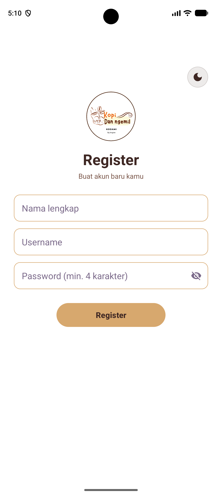
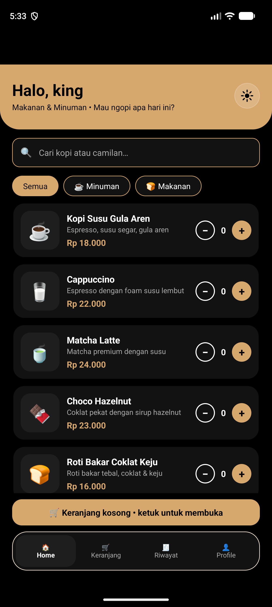

# ☕ Kopi dan Nyemil

Aplikasi mobile Android sederhana untuk memesan kopi dan camilan, dibuat untuk **Ujian Tengah Semester – Pemrograman Mobile**.

**Nama:** Muhamad Giast Al-Munawar (KinGiast)
**NIM:** 1247050129 | **Kelas:** B
**Program Studi:** Teknik Informatika, UIN Sunan Gunung Djati Bandung
**GitHub:** [kangti7/kodami](https://github.com/kangti7/kodami)

## Deskripsi
Kopi dan Nyemil adalah aplikasi pemesanan makanan & minuman. Pengguna dapat mendaftar, login, memilih menu, mengisi alamat pengiriman, dan menerima konfirmasi pesanan. Aplikasi ini tidak memakai database; semua data berupa data statis (dummy) yang disimpan di memori.

## Fitur
- **Splash/Welcome** – halaman pembuka dengan tombol *Start now*
- **Sign Up** – pilihan Register atau Login
- **Akun tersimpan** – akun hasil Register disimpan di perangkat (SharedPreferences), jadi tetap bisa login setelah aplikasi ditutup
- **Ikon aplikasi** – ikon cangkir kopi buatan sendiri (adaptive icon)
- **Register** – daftar akun (nama lengkap, username, password) dengan validasi input dan tombol lihat/sembunyikan password
- **Login** – validasi username & password, dengan tombol lihat/sembunyikan password (akun demo untuk pengujian: `admin` / `admin`)
- **Home** – sapaan nama pengguna, 8 menu makanan/minuman, filter kategori (Semua/Minuman/Makanan), tombol +/− jumlah pesanan, ringkasan keranjang (jumlah item & total), animasi saat daftar muncul
- **Pencarian menu** – kolom cari di Home yang bekerja bersama filter kategori
- **Foto menu** – kartu menu menampilkan foto (res/drawable); bila foto belum ada otomatis memakai emoji
- **Konfirmasi Logout** – dialog "Ya, Logout / Batal" sebelum keluar akun
- **Pesan Lagi** – di Riwayat, memasukkan ulang item pesanan lama ke keranjang
- **Dark Mode & Light Mode** – dua mode tampilan, ganti lewat ikon bulan/matahari (Splash, Home, Profile) atau pilihan *Terang/Gelap* di Profile; pilihan tersimpan (SharedPreferences), awalnya mengikuti pengaturan sistem
- **Notifikasi dalam aplikasi** – banner custom (sukses/error/info) menggantikan Toast bawaan Android
- **Keranjang** – halaman keranjang bisa dibuka kapan saja (tanpa harus memesan), ubah jumlah, lihat total, lalu checkout
- **Riwayat Pesanan** – daftar pesanan dengan status *Pesanan dibuat → Sedang disiapkan → Sedang dikirim → Pesanan diterima*, jam tiap tahap, dan estimasi tiba (status disimulasikan berdasarkan waktu)
- **Bottom Navigation** – Home, Keranjang, Riwayat, Profile
- **Profile** – ubah nama pengguna dan Logout
- **Alamat Pengiriman & Pembayaran** – nama penerima, nomor telepon, alamat lengkap, dan pilihan metode pembayaran dummy (COD, Transfer Bank, GoPay, OVO, DANA, QRIS) dengan validasi
- **Konfirmasi Pesanan** – ringkasan pesanan, total, dan alamat tujuan

## Desain & UI
- Tema warna kopi (coklat tua, krem, karamel) dengan header gradien bermelengkung
- Splash dengan gradien dan animasi logo, card menu dengan elevasi, chip filter kategori, stepper jumlah pesanan
- Material 3 (MaterialButton, MaterialCardView), teks berwarna ungu
- Dua tema: Terang & Gelap (values / values-night)

## Alur Aplikasi
Splash → Sign Up → (Register → Login) → Home → Keranjang → Alamat → Konfirmasi → Riwayat
Home ⇄ Keranjang ⇄ Riwayat ⇄ Profile (lewat bottom navigation)

## Teknologi
- Bahasa: Kotlin
- UI: XML Layout + Material Components (Material 3)
- IDE: Android Studio
- Min SDK: 27 (Android 8.1), Target SDK: 37
- Data: dummy data (object `AppData`), riwayat pesanan disimpan di SharedPreferences (JSON), tanpa database

## Struktur Proyek
```
app/src/main/
├── java/com/example/kopidannyemil/
│   ├── SplashActivity.kt        ├── KeranjangActivity.kt
│   ├── SignUpActivity.kt        ├── RiwayatActivity.kt
│   ├── RegisterActivity.kt      ├── AppData.kt (data menu & akun)
│   ├── LoginActivity.kt         ├── OrderStore.kt (riwayat pesanan)
│   ├── HomeActivity.kt          ├── ThemeHelper.kt (dark/light mode)
│   ├── ProfileActivity.kt       ├── Notif.kt (notifikasi dalam aplikasi)
│   ├── AlamatActivity.kt        ├── Nav.kt, Insets.kt, UiHelpers.kt
│   └── KonfirmasiActivity.kt    └── PasswordToggle.kt
└── res/ (layout, drawable, drawable-night, values, values-night, mipmap)
```

## Cara Menjalankan
1. Clone repository: `git clone https://github.com/kangti7/kodami.git`
2. Buka folder `kodami` dengan **Android Studio**
3. Tunggu proses *Gradle Sync* selesai
4. Pilih emulator atau perangkat Android (minimal Android 8.1 / API 27)
5. Pastikan konfigurasi run bernama **app**, lalu klik **Run ▶**
6. Login memakai akun demo `admin` / `admin`, atau Register akun baru

> Catatan: status pesanan di halaman Riwayat berjalan otomatis sebagai **simulasi** (sekitar 70 detik dari "Pesanan dibuat" sampai "Pesanan diterima").

## Screenshot
| Splash (Light) | Splash (Dark) | Sign Up (Light) | Sign Up (Dark) |
|---|---|---|---|
|  |  |  |  |

| Register | Login | Home | Home (Dark Mode) |
|---|---|---|---|
|  |  |  |  |

| Keranjang | Alamat | Konfirmasi | Riwayat |
|---|---|---|---|
|  |  |  |  |

| Profile | Notifikasi |
|---|---|
|  |  |
